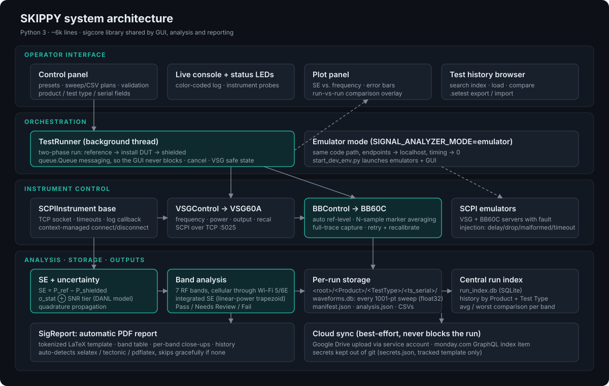
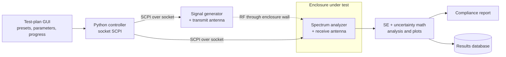
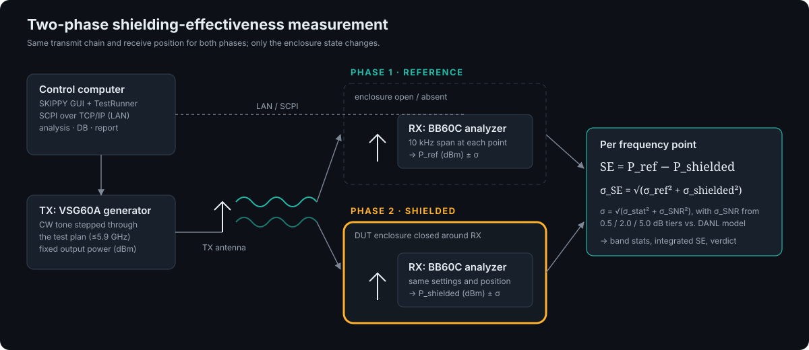
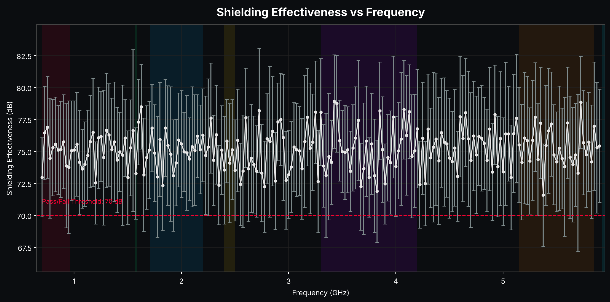
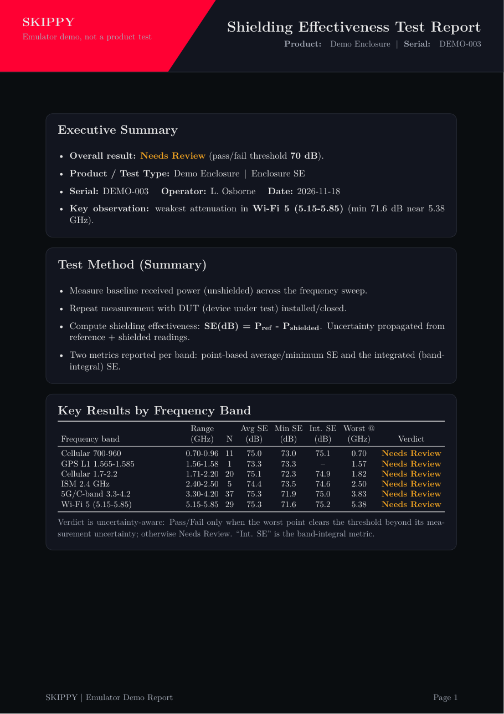
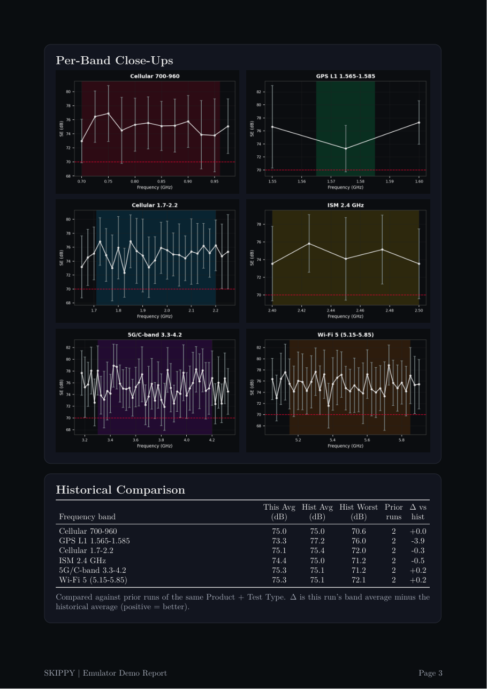

# SKIPPY: Automated RF Shielding-Effectiveness Test Bench

**Landon Osborne** · R&D Project Coordinator, MOS Equipment (Mission Darkness / Generation Faraday) · 2024–2026

**▶ [Project presentation](https://landotosborne.github.io/skippy-se-test-bench/)** · [Sample auto-generated report (PDF)](sample-output/demo_report.pdf)

SKIPPY is the Python test system I designed and built to measure how well RF shielding enclosures (Faraday bags, tents and boxes) block signals from 100 MHz to 6 GHz. It drives a signal generator and a spectrum analyzer over SCPI/TCP, computes shielding effectiveness (SE) with propagated measurement uncertainty, and turns every run into a stored, searchable, reported result.

Before SKIPPY, SE was measured by hand at about **3 single-frequency readings per minute**. SKIPPY replaced that with automated full-band sweeps, roughly **one sweep of thousands of points per second**, plus analysis, a database and a finished report with no manual steps. It was later extended to **pre-shipment SE testing of production units**.

| | Before SKIPPY | With SKIPPY |
| --- | --- | --- |
| Method | Manual, one frequency at a time | Automated swept measurement |
| Speed | About 3 single-frequency readings per minute | About one full-band sweep per second |
| Points per sweep | 1 | Thousands |
| Coverage | Spot frequencies | 100 MHz – 6 GHz continuous |
| Output | Hand-recorded numbers | Analysis, charts, compliance report and database record for every run |

> **About this repository.** The source code is proprietary to my former employer and is kept in a private repository, shared with their permission. This public repo is a portfolio overview. All figures and sample outputs here come from the real program running against its bundled **instrument emulators**, so no customer or product test data is published.

---

## What I built

I owned the whole system: the transmit/receive hardware chain, the SE and error-propagation math, the Python socket/SCPI instrument control, and the software around it.

| Layer | What it does |
|---|---|
| **Instrument control** | `SCPIInstrument` base class over raw TCP sockets; drivers for a Signal Hound VSG60A generator and BB60C analyzer. Automatic reference-level ranging, N-sample marker averaging, full-trace capture, timeout retry with recalibration, and a safe output state on exit. |
| **Orchestration** | Two-phase run (reference → install DUT → shielded) on a background thread with queue messaging, so the GUI never blocks; cancel at any point. |
| **Measurement math** | `SE = P_ref − P_shielded` per point. Uncertainty combines sample scatter with an SNR-dependent term from a frequency-dependent noise-floor (DANL) model, propagated in quadrature. |
| **Band analysis** | Seven RF bands (cellular, GPS L1, 2.4 GHz ISM, 5G/C-band, Wi-Fi 5/6E): average, minimum and worst frequency, plus **integrated SE** over each band (trapezoidal integration in linear power). Uncertainty-aware **Pass / Needs Review / Fail** verdict. |
| **Data system** | Standard run taxonomy `<Product>/<TestType>/<timestamp_serial>/`; per-run SQLite `waveforms.db` holding every 1001-point sweep as compact float32 blobs; central `run_index.db` for historical comparison; manifests, a searchable index, and portable `.setest` archives. |
| **Reporting** | Tokenized LaTeX template rendered from a structured `analysis.json`: band table, full sweep, per-band close-ups and history vs. prior runs. Compiles to PDF automatically when a TeX engine is present. |
| **Integrations** | Best-effort Google Drive upload (service account) and monday.com run index (GraphQL). A sync failure is logged and never costs a local result. |
| **Operator GUI** | CustomTkinter app with test presets, input validation, live console, instrument status LEDs, SE plot with error bars, history browser and run-vs-run comparison. |
| **Dev tooling** | SCPI emulators for both instruments with fault injection (delay, dropped/malformed responses, disconnects, timeouts), and an emulator mode that runs the same code path with zero settle time. |

### Signal flow

## Measurement method

For each frequency in the test plan, the generator transmits a CW tone and the analyzer, at a fixed position, measures received power in a 10 kHz span. The run is repeated with the enclosure closed around the receiver:

- **SE (dB)** = P_ref − P_shielded
- **σ_SE** = √(σ_ref² + σ_shielded²), where each σ = √(σ_stat² + σ_SNR²) and σ_SNR is 0.5, 2.0 or 5.0 dB depending on the signal's margin above the modeled noise floor.

The pass/fail logic respects that uncertainty: a band **passes** only if its worst point clears the threshold by more than its uncertainty, **fails** only if it misses by more than its uncertainty, and is otherwise flagged **Needs Review** instead of being forced into a false pass or fail.

The method was designed to be IEEE 299-compatible and to check enclosures against MIL-STD-188-125 HEMP SE values. It is a verification tool, not a certified test facility.

## Sample output (emulator run)

Three consecutive emulator runs of a simulated ~75 dB enclosure, swept 0.7–5.9 GHz in 25 MHz steps with 3-sample averaging. Each run stored 418 measurement points and 1,254 full sweeps (~1.25 million samples) in its waveform database and produced the report below automatically.

Every band averages about 75 dB, and every minimum sits above the 70 dB threshold. But each band's worst point is within 3–4 dB of measurement uncertainty of that threshold, so SKIPPY reports **Needs Review**, not a confident pass. That's the behavior I wanted from a production screening tool.

| Report: summary and band table | Report: per-band close-ups |
|---|---|
|  |  |

Files in [`sample-output/`](sample-output/): the full PDF report, `analysis.json` (the structured result the report renders from), the band table CSV and the point-by-point SE results.

## Tech

Python 3 · NumPy · Pandas · Matplotlib · CustomTkinter · SQLite · sockets/SCPI · LaTeX (XeLaTeX) · Google Drive API · monday.com GraphQL API · Git

## Contact

Landon Osborne · Tacoma, WA · [Ltosborne46@gmail.com](mailto:Ltosborne46@gmail.com) · [github.com/landotosborne](https://github.com/landotosborne)
