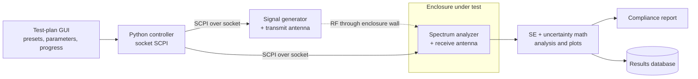

# SKIPPY: Automated Shielding-Effectiveness Test Bench

**MOS Equipment (Mission Darkness / Generation Faraday) · Built 2024, developed through 2026**
Designed, sourced and built by Landon Osborne

> **About this repository:** this is a technical write-up. SKIPPY's source code belongs to MOS Equipment and isn't published here yet. A public release is under discussion because customers have asked for it.

SKIPPY is a Python test system that measures how well a Faraday enclosure blocks RF energy (shielding effectiveness, SE) from **100 MHz to 6 GHz**. It replaced hand measurements, taken one frequency at a time, with automated full-band sweeps, and it is now also used for pre-shipment SE checks on production units.

## Results

| | Before SKIPPY | With SKIPPY |
| --- | --- | --- |
| Method | Manual, one frequency at a time | Automated swept measurement |
| Speed | About 3 single-frequency readings per minute | About one full-band sweep per second |
| Points per sweep | 1 | Thousands |
| Coverage | Spot frequencies | 100 MHz – 6 GHz continuous |
| Output | Hand-recorded numbers | Analysis, charts, compliance report and database record for every run |

## How it works

1. **Set up the test.** An interactive GUI records the test parameters (product, setup, frequency plan) from saved presets and starts the run. Custom setup jigs standardize the physical test setup.
2. **Sweep.** A Python socket link drives the instruments with SCPI commands: a signal generator transmits outside the enclosure, and a spectrum analyzer inside the enclosure records received power across the band.
3. **Compute SE.** Shielding effectiveness at each frequency is the drop in received power between a reference measurement and the shielded measurement, in dB. Measurement uncertainty is propagated to every point.
4. **Report and store.** When the run finishes, SKIPPY analyzes and charts the results, generates a test report, and saves everything to a local database for comparison across designs and production units.

## Design notes

- **Standards:** designed to be compatible with the IEEE 299 method for measuring enclosure shielding effectiveness. SKIPPY is not a certified test lab.
- **Whole-system ownership:** I sourced and built the transmit/receive hardware chain and designed the SE and error-propagation math, instrument control, GUI, analysis, reporting and database myself.
- **Production use:** adapted from an R&D tool into a pre-shipment compliance check for finished units (mainly the BBL-XL), plus setup troubleshooting for the team.
- **Where it's used:** SE testing and leak searching during product development (for example, the Cyphercylent tent vestibule) and verification of new designs.

## Tech

Python (NumPy, Pandas) · TCP sockets · SCPI instrument control · GUI · local database · signal generator · spectrum analyzer · SE test antennas · RF cables and connectors

<!-- TODO (Landon): add a sanitized example SE plot (docs/example-sweep.png) and a photo of the bench setup, if MOS is OK with it. -->
